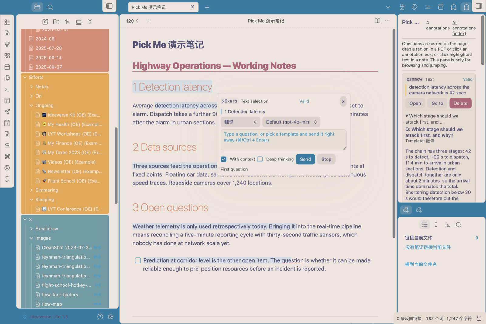
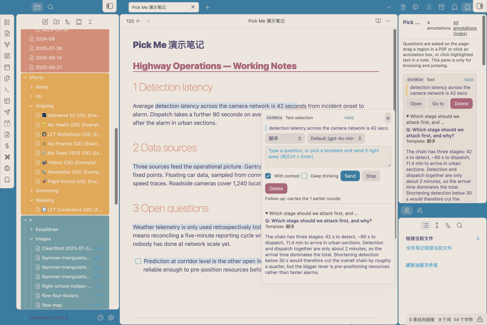
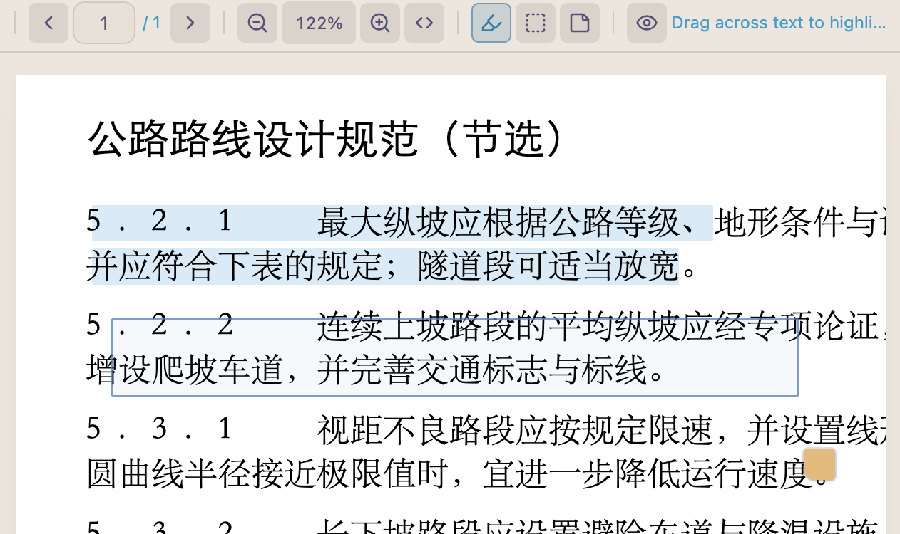
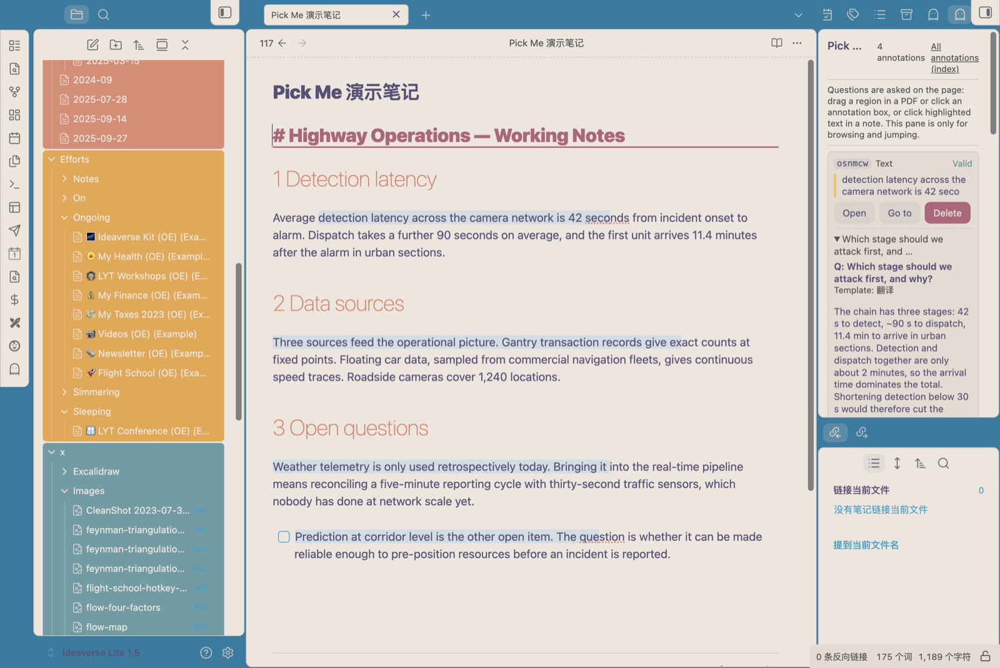
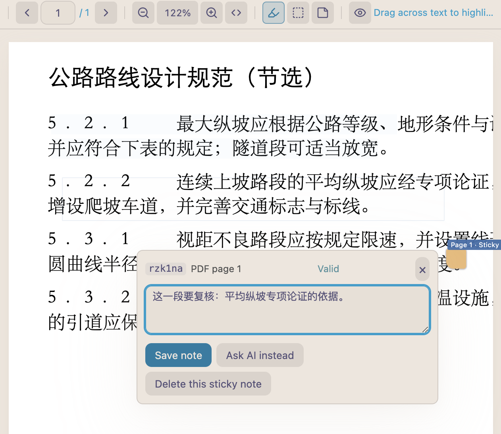
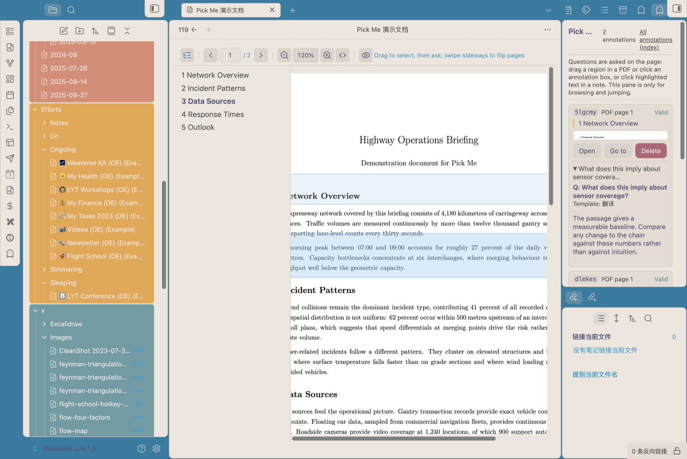

# Pick Me

Highlight, annotate and ask about what you select — in notes and in PDFs — without leaving the page.

**English** | [中文](README.zh.md)

Every annotation lives in its own Markdown file and stays linked to the source — the original document is never modified, not a single byte.

## Screenshots

| Select and ask | The answer, stored with the annotation |
| --- | --- |
|  |  |
|  |  |
|  |  |

In a PDF there are three annotation tools, side by side in the toolbar (the active one keeps an accent background, and the pointer changes with it):

| Tool | How | What you get |
| --- | --- | --- |
| **Highlighter** | Drag across text | A clean band snapped to the lines — **nothing pops up**; click it to write a note. Dragging straight down highlights whole lines; starting the next stroke on an existing highlight (or the line next to it) merges into it |
| **Region** | Drag a rectangle | The ask panel opens the moment you release; the region's text and a screenshot go to the model together |
| **Sticky note** | Click anywhere on the page | Only a small icon stays on the page; click it to read or write (several lines are fine). The icon can be **dragged** to another spot — in any mode |

The highlighter and the region tool can be combined on one annotation (a band for the text, an outline for the area). Right after a stroke or a drop, `Escape` takes that step back: a new highlight or an empty sticky note is removed entirely, while a merged stroke only gives back what it added.

Drag a rectangle over a PDF page — the text of that region and its screenshot go to the model together, and the box stays on the page to reopen later (the viewer with its outline is the last screenshot below).

## Install

- **Community plugins** (after this plugin is published): Settings → Community plugins → Browse → search *Pick Me* → Install → Enable.
- **BRAT** (beta builds, works before publication): install [BRAT](https://github.com/TfTHacker/obsidian42-brat), then *Add beta plugin* → `<your-github-user>/pickme`.
- **Manual**: put `main.js`, `manifest.json` and `styles.css` into `<vault>/.obsidian/plugins/pickme/`, then enable it in Settings.

Desktop only (`isDesktopOnly`) — the built-in pdf.js viewer and region screenshots need desktop capabilities.

## Network use and privacy

This plugin collects nothing and has **no telemetry**. It does need network access to the model endpoint *you* configure:

- The only destination it ever contacts is the **OpenAI-compatible endpoint you enter in the settings**. The text you select (and optionally the PDF region screenshot) is sent there to generate an answer; what happens to it is up to whichever provider you point it at.
- Your **API key** is stored in plain text in `.obsidian/plugins/pickme/data.json`, like any other Obsidian plugin's settings. It is never sent anywhere except the endpoint you configured.
- Everything except "asking a question" works **offline**: annotations, anchors, highlights and the index are local operations. Note text is only sent when you ask, and only the selection (plus optional surrounding context, and the whole note if a template opts in via `pickme_include_note`).
- PDF rendering needs no downloads: pdf.js's CMap tables and standard fonts are **inlined into `main.js`** at build time.
- The plugin writes only inside your vault (by default `.obsidian/plugins/pickme/`: annotation files, templates, the generated index) and reads nothing outside the vault.

## Use it

Interactions happen on the page. The sidebar is only for reviewing existing annotations.

### In a note (Markdown)

1. Select some text → right-click → **Pick Me: Ask or annotate** (or run the same command from the command palette).
2. The plugin inserts an empty anchor tag pair around the selection; the text and formatting inside are untouched.
3. A panel opens next to the selection: choose a template or type your own question. Asking again on the same annotation is a follow-up — the previous exchanges are sent along.
4. Click the highlighted text later to reopen that annotation's panel.

### In a PDF

1. PDFs open in Pick Me's built-in pdf.js viewer by default (can be turned off in the settings).
2. Pick a tool in the toolbar first (**Highlighter / Region / Sticky note**): the active icon keeps an accent background and the pointer changes (marker / crosshair / sticky note).
3. **Highlighter**: swipe across text and it snaps into bands on release — a band only spans the stretch you painted; dragging straight down highlights whole lines; starting the next stroke on an existing highlight merges into it, with no panel in the way. `Escape` right after a stroke takes it back; click a highlight to write a note.
4. **Region**: drag a rectangle and the ask panel opens right there, with the region's screenshot sent to the model as an image.
5. **Sticky note**: click anywhere to drop a small icon (only the icon shows on the page), and a note box opens for you to write in; press `Escape` without writing and it is gone. The icon can be dragged anywhere, in any mode.
6. Click any mark already on the page to open that annotation with its history. Highlights and sticky notes open a **note box** (write a line or a paragraph, or switch to the question composer with “Ask AI instead”); a region opens the ask panel.
7. Close the panel with `×` or `Escape`. A region you just drew that has no question yet is **undone** when you close the panel; once you have asked something it stays.
8. The toolbar is grouped by function, left to right, separated by hairline dividers: **outline** (only when the PDF has bookmarks) | **paging** | **zoom** | **annotation tool** (highlighter / region / sticky note, mutually exclusive) | **display** (highlight toggle). Toolbar buttons are icon-only with tooltips, and the grey text at the far right is the current status.
9. The delete button in the panel only appears **after** you have asked something — a region with no question is removed by closing the panel. Deleting also removes its box from the page (with a confirmation).

**All pages sit in one scroll container**, like the built-in PDF reader: the scrollbar represents the whole document, and the page box follows it.

| Way to move | How |
| --- | --- |
| Wheel / trackpad | Scroll continuously; PageUp/PageDown/Home/End scroll natively |
| Buttons / page box | Toolbar previous/next page, or type a page number and press Enter |
| Trackpad swipe | Swipe sideways to flip a page (needs ~120px so it doesn't fire by accident) |
| Keyboard | ← / → flip pages (the page box keeps focus; when zoomed in far enough to scroll sideways, arrows stay native) |

Only pages near the viewport are rendered; far-away canvases are released and repainted when you scroll back, so a 100-page PDF does not eat hundreds of MB.

**Outline**: PDFs with bookmarks (usually standards, manuals, datasheets) get an outline panel on the left; click an entry to jump to that page. PDFs without bookmarks get no outline button at all. The open/closed state is remembered.


### Annotation index (one screen for the whole vault)

Run the command **Open annotation index** to get a sidebar listing every annotation in the vault, grouped by source document: selection snippet or PDF page, question count, anchor id and creation time.

- Click a document name to open it; click an entry to open the source and jump to that annotation. Fully keyboard operable (Tab + Enter).
- PDF annotations carry a thumbnail of the region; text annotations show the snippet.
- Filter box on top (document name, selection text or anchor id).
- Annotations whose anchor can no longer be found in the source (you edited that paragraph, or deleted the tag pair) are **never deleted** and never mixed into the normal list: they collect into a collapsible `Stale (N)` row at the end of each group, with the reason spelled out. Use the command **Rebind stale anchors** to re-attach one by re-selecting the text in the source.
- The index reads the annotation files directly, so it is always current. The plugin also maintains an `annotations-index.md` summary inside its own (hidden) plugin folder — an internal artifact with no setting; handlers that want it can point Dataview at the plugin folder.

### Templates

A template is just a prompt. Three are built in — **Explain / Summarize / Translate** — and every `.md` file in the template folder is a template; the **file name is the name in the dropdown**.

Variables: `{{选区}}` (selection), `{{提问}}` (question), `{{上下文}}` (context), `{{笔记标题}}`, `{{源路径}}`, `{{页码}}`, `{{已有批注}}`, `{{区域图片}}`. A line whose variables are all empty is dropped entirely, so optional paragraphs are safe.

Frontmatter can override per-template behaviour:

```yaml
pickme_model: qwen/qwen3.8-flash-next   # model for this template (empty = default)
pickme_temperature: 0.7                  # override temperature
pickme_include_note: false               # also send the whole note
pickme_vision: true                      # send the PDF region screenshot
pickme_context: false                    # attach surrounding context
```

### Model channel

Point the plugin at any OpenAI-compatible endpoint (official API, a gateway, an intranet service). The settings cover the base URL, API key, default model, temperature, streaming, deep thinking, an optional vision model, and the maximum output length. **Test connection** sends a minimal request to check the credentials.

Two things worth knowing:

- **Deep thinking** (on by default) makes the model reason before answering: better answers, slower. The reasoning budget is separate and does **not** consume the maximum output length.
- **Interface language** switches the plugin's own UI between English and Chinese, immediately, without a restart. It never translates your notes or annotation files.

Full section-by-section explanation of every setting: [README.zh.md](README.zh.md#设置项说明) (Chinese).

## Changelog

One line per release; the full notes live in [CHANGELOG.md](./CHANGELOG.md).

| Version | Highlights |
| --- | --- |
| 1.0.14 | Fixed: a multi-line selection in a note was saved as its first line only, then marked stale (community contribution) |
| 1.0.13 | Saving a sticky note closes its box |
| 1.0.12 | Sticky notes can be dragged anywhere; paler icon |
| 1.0.11 | Sticky notes (a third annotation tool); notes can run several lines |
| 1.0.10 | Continued strokes merge into one highlight; a vertical drag highlights whole lines; finishing a stroke opens nothing |
| 1.0.9 | Highlights take a one-line note; your own stroke shows while dragging; only what you paint is covered |
| 1.0.8 | The pointer distinguishes the three tools; the active tool is marked on the toolbar |
| 1.0.7 | The highlighter only highlights (click it to write a note); `Escape` takes back a fresh highlight |
| 1.0.6 | PDF highlighter annotations (strokes snap to text lines); PDFs remember where you stopped reading |
| 1.0.5 | Fixed empty-folder cleanup that never ran |
| 1.0.4 | No empty folder left behind when deleting an annotation; committed generated assets; gzip header fix |
| 1.0.3 | Inlined assets packed as one gzip stream — smaller install, fewer failures |
| 1.0.2 | The ask panel no longer preselects the first template |
| 1.0.1 | `minAppVersion` raised to 1.7.2; panel component lifecycle fixes |
| 1.0.0 | First release: ask about note selections and PDF regions, annotations in their own files, index and reverse navigation |

## Limitations

- `main.js` is about 3.8 MB because pdf.js's CMap tables and standard fonts are inlined — the price of needing no network for PDF rendering. They ship as one gzip stream per group and are decompressed once, on demand, so the download stays as small as this feature allows.
- Desktop only.
- When the window is minimized or fully occluded, Chromium stops `requestAnimationFrame` and pdf.js rendering pauses; it repaints when the window returns.
- Anchor tags are visible in source mode (`<pickme id="xxxxxx"></pickme>`) but hidden in editing and reading views.
- Highlights rely on the reading-view post-processor and a CodeMirror extension; if another plugin decorates the same text, Obsidian's render wins.

## Development

```bash
npm install
npm run dev        # watch build
npm run verify     # typecheck + unit tests + build + smoke test
npm run build      # produce main.js
node scripts/install.mjs "/path/to/vault"          # symlink the project into a vault (dev)
node scripts/install.mjs "/path/to/vault" --copy   # copy the built files instead
```

The repository ships the plugin source and build scripts only. Design and acceptance documents stay in the private development repository.

`src/generated/pdfAssets.ts` (pdf.js CMap tables and standard fonts, ~1.8 MB of base64) **is committed on purpose**: static analysis and type checking have to resolve it, and an unresolved import degrades to `any`, which shows up as spurious `unsafe-*` findings in the plugin review. Regeneration is deterministic, and CI fails if it drifts from `pdfjs-dist`.

## License and third-party components

- This plugin: MIT, see [LICENSE](./LICENSE).
- Bundles [pdf.js](https://github.com/mozilla/pdf.js) (`pdfjs-dist@4.10.38`, Apache-2.0) for PDF rendering; its CMap tables and standard fonts are inlined by `scripts/inline-pdf-assets.mjs`.
- pdf.js contains font-rendering code paths that build functions with `new Function`. Pick Me disables them (`isEvalSupported: false` in `src/pdf/pdfjs.ts`), so no generated code is ever evaluated — the automated review still shows a "dynamic code execution" note because that code is present in the bundle.
